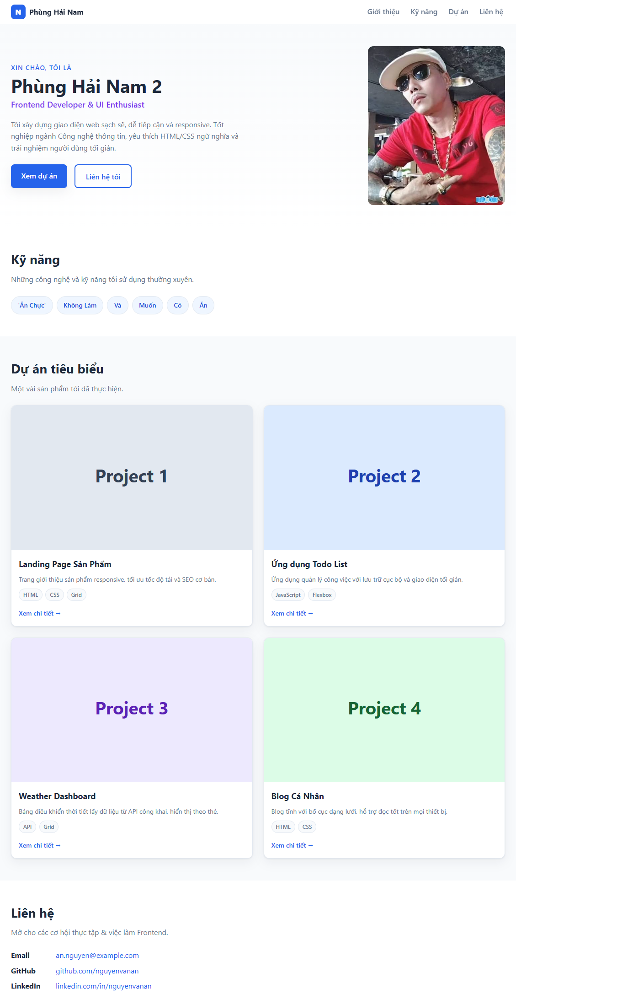
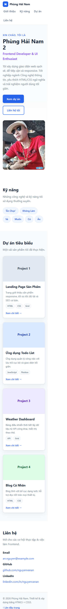

# Báo cáo kiểm thử Portfolio CV

## Thông tin kiểm thử

- **Đối tượng:** Portfolio cá nhân Phùng Hải Nam.
- **Ngày kiểm thử:** 2026-10-27.
- **Phạm vi:** Trang tĩnh HTML/CSS hiện có trong repository.
- **Phương pháp:** Mở trang bằng trình duyệt tích hợp, quan sát giao diện ở màn hình rộng và màn hình hẹp, kiểm tra trạng thái tải ảnh và đối chiếu các anchor trên trang. Đánh giá cấu trúc mã nguồn bằng cách đọc HTML/CSS.
- **Ảnh minh chứng:** Tự chụp từ trang đang chạy và lưu tại `docs/screenshots/`.

## Kết quả theo tiêu chí

| Tiêu chí | Kết quả | Nhận xét và minh chứng |
|---|---|---|
| Tính đúng đắn | Đạt một phần | Trang mở được; tiêu đề, các khu vực Giới thiệu, Kỹ năng, Dự án, Liên hệ và Footer hiển thị. Ảnh đại diện cùng 4 ảnh dự án đều tải thành công. Các anchor `#top`, `#about`, `#skills`, `#projects`, `#contact` có phần tử đích. Tuy nhiên, nội dung kỹ năng và hồ sơ liên hệ còn là dữ liệu mẫu; liên kết chi tiết dự án đang dùng `href="#"`. |
| UI/UX | Đạt trong phạm vi đã kiểm tra | Bố cục thích ứng từ màn hình rộng sang màn hình hẹp; lưới dự án chuyển từ nhiều cột sang một cột, nội dung không tràn ngang theo số đo DOM trong lần kiểm tra. Header và điều hướng có thể xuống dòng trên màn hình hẹp. Ảnh desktop và mobile bên dưới là minh chứng trực quan. Chưa thực hiện đánh giá khả năng tiếp cận chuyên sâu với screen reader hoặc kiểm tra tương phản tự động. |
| Khả năng vận hành - xử lý lỗi | Đạt với trang tĩnh; chưa áp dụng cho xử lý lỗi động | Trang HTML mở được trực tiếp từ đường dẫn cục bộ và tài nguyên ảnh tải thành công. Dự án không có JavaScript, backend, biểu mẫu gửi dữ liệu hoặc API; do đó không có luồng nghiệp vụ động để kiểm tra xử lý lỗi. Chưa thử lỗi máy chủ triển khai hoặc lỗi mạng production. |
| Bảo mật | Đánh giá sơ bộ, chưa kiểm thử bảo mật đầy đủ | Phạm vi hiện tại là trang tĩnh, không nhận đầu vào người dùng, không dùng backend, thư viện runtime hay khóa bí mật. Điều này giới hạn bề mặt tấn công của ứng dụng, nhưng không thay thế cho quét lỗ hổng. Chưa chạy công cụ SAST/DAST, chưa kiểm tra cấu hình HTTPS, header bảo mật hoặc máy chủ lưu trữ. |
| Chất lượng mã nguồn | Đạt cơ bản | HTML sử dụng các phần tử ngữ nghĩa như `header`, `nav`, `main`, `section`, `article`, `footer`; ảnh có văn bản thay thế; CSS tách riêng, sử dụng custom properties, Flexbox, Grid và media queries. Chưa chạy HTML validator, CSS linter hoặc kiểm tra tự động. Cần thay dữ liệu mẫu và các liên kết `#` trước khi phát hành. |
| Khả năng triển khai | Có thể triển khai dưới dạng trang tĩnh; chưa xác nhận production | Không có bước build hay dependency cài đặt. Có thể phục vụ thư mục dự án bằng máy chủ web tĩnh. Repository hiện không có Dockerfile hoặc pipeline triển khai; kiểm thử này chưa dựng container, cấu hình tên miền/HTTPS hay xác nhận triển khai lên hosting production. |

## Ảnh minh chứng

### Màn hình rộng

### Màn hình hẹp

## Kết luận

Portfolio đáp ứng các kiểm tra cơ bản về khả năng tải trang, hiển thị nội dung, tải ảnh và bố cục responsive trong phạm vi đã thử. Trước khi phát hành, cần cập nhật nội dung cá nhân và liên kết thật; nếu triển khai công khai, cần kiểm tra thêm hosting, HTTPS/header bảo mật và các công cụ kiểm định tự động.
